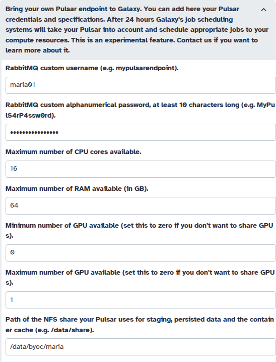

# byoc-sync

byoc-sync turns the "Bring your own compute" (BYOC) Pulsar requests that Galaxy users enter in their preferences
into pull requests against an infrastructure-playbook repository (for usegalaxy.eu,
`usegalaxy-eu/infrastructure-playbook`). byoc-sync only edits files in a checkout of that repository and opens pull
requests; it never runs Ansible. Admins review and merge the pull requests; nothing reaches production without that.

Read in order: "How it works", "Try it locally", "Quick start" (your own Galaxy), "Setting it up" and "Running in CI".
"How it behaves" explains the rules; "Reference" lists every option.

For each request it adds, updates or removes the entries the endpoint needs:

| File (usegalaxy.eu layout)             | Entry                                                           |
| -------------------------------------- | --------------------------------------------------------------- |
| `group_vars/mq.yml`                    | RabbitMQ user and vhost `galaxy_<name>_byoc`                    |
| `templates/galaxy/config/job_conf.yml` | Pulsar MQ runner `pulsar_eu_<name>_byoc`                        |
| `files/galaxy/tpv/destinations.yml.j2` | TPV destination `pulsar_<name>_byoc_tpv` with the user's limits |
| `files/galaxy/tpv/users.yml`           | TPV rule that routes the user's jobs to their endpoint          |
| `secret_group_vars/pulsar.yml`         | the RabbitMQ password, in the Ansible vault                     |

## How it works

1. **A user fills in the form**: the `byoc_pulsar` section of their Galaxy user preferences. It asks for a BYOC name
   (typed into the form's RabbitMQ `username` field), a password, CPU/memory/GPU limits and, optionally, an NFS path
   for the staging, persisted data and container cache directories.
2. **byoc-sync runs**, usually from CI. It reads the forms (through the Galaxy API or gxadmin), checks them and gives
   every user one action: create, update, delete, invalid and so on (see "Actions per user").
3. **It opens one pull request per changed user.** Only that user's entries are edited, line by line (see "How files
   are edited"); `--single-pr` puts all changes into one. With `--dry-run` it prints the plan and the diff instead.
4. **An admin reviews and merges the pull request.** The endpoint is used once the playbook is deployed.

## Terms

- **user**: a Galaxy account, identified by its e-mail address.
- **BYOC name**: what the user types into the form's RabbitMQ `username` field, for example `alice01`. Every
  entry byoc-sync writes is named after it. In tables it is written `<name>`; in site config patterns `{x}`,
  and `{x_dash}` is the same name with `-` instead of `_` (written `<name-dash>` in tables). A BYOC name has
  3-32 characters: lowercase letters, digits and `_`, starting with a letter, not ending in `_` or `_byoc`,
  without `__`. Validation errors call it by its form field, `username`.
- **owner**: the user a BYOC name belongs to (see "Ownership and removal"). This is not the GitHub repository owner in
  `--github-repo OWNER/REPO`.
- **endpoint**: the user's own Pulsar server, together with the entries that connect it to Galaxy.

## Try it locally

One command sets everything up on your machine and shows a dry run, without GitHub and without touching the playbook
repo you point it at:

```bash
scripts/bootstrap ../infrastructure-playbook     # a path or URL of the playbook repo
```

You need `git`, `docker`, `curl` and [uv](https://docs.astral.sh/uv/). The script

1. creates `.venv` with byoc-sync and its test dependencies;
2. starts a throw-away Galaxy 26.1 on PostgreSQL (in docker, no volumes) at http://127.0.0.1:8089 and creates test
   users who filled in the BYOC form: valid requests, invalid ones, a name claimed twice and so on (see
   `testenv/seed_users.py`; every test account's password is `testpass123`);
3. makes a throw-away copy of the playbook repository you pass in, so that repository is never touched (details
   below);
4. runs `byoc-sync --dry-run` against it and prints the command to run it again.

The first run takes a while because Galaxy installs its dependencies. Afterwards, change a user's preferences in
Galaxy, or run `testenv/setup.sh seed phase2` for a prepared set of changes (new limits, a new password, a cleared
form, a deleted account), and rerun the printed command to see how byoc-sync reacts. Add `--allow-delete` to see
removals planned. `testenv/setup.sh down` stops Galaxy and removes the database. To only run the tests:
`scripts/bootstrap --tests-only`.

<details>
<summary>The throw-away playbook copy, and the test environment's settings</summary>

- `testenv/state/demo-origin.git` is a bare clone of the repository you pass in. It stands in for GitHub, so pushes
  land here and go nowhere else.
- `testenv/state/demo-playbook` is a working checkout of that bare clone, on a new branch `byoc-demo` that byoc-sync
  uses as its base branch (`--base-branch byoc-demo`).
- On `byoc-demo` the real vault (`secret_group_vars/pulsar.yml`, which you can't decrypt without the real password) is
  replaced by a dummy one. It holds the same `rabbitmq_password_*` variable names, each with the value `dummy`, and is
  encrypted with a random password stored in `testenv/state/demo-vault-pass`. That lets byoc-sync decrypt and edit it
  like the real one.

`testenv/setup.sh` reads these environment variables (all optional; for example `GALAXY_PORT` for another port):

| Variable        | Default                                   | Meaning                                                        |
| --------------- | ----------------------------------------- | -------------------------------------------------------------- |
| `GALAXY_PORT`   | `8089`                                    | port of the test Galaxy (`setup.sh url` prints its URL)        |
| `PG_PORT`       | `55432`                                   | host port of the PostgreSQL container                          |
| `PG_CONTAINER`  | `byoc-sync-pg`                            | name of the PostgreSQL container                               |
| `GALAXY_SOURCE` | `https://github.com/galaxyproject/galaxy` | Galaxy repository to clone                                     |
| `GALAXY_REF`    | `release_26.1`                            | Galaxy branch or tag                                           |
| `ADMIN_KEY`     | `byoc-sync-testenv-admin-key`             | bootstrap API key of the test Galaxy's admin                   |
| `PYTHON`        | `python3`                                 | Python that runs `testenv/seed_users.py` (`seed`, `admin-key`) |

</details>

## Quick start

```bash
pip install .                         # or: uv pip install .

export GALAXY_API_KEY=...             # Galaxy admin API key
export BYOC_SYNC_VAULT_PASSWORD=...   # vault password (or --vault-password-file)

# See what would change. Nothing is pushed.
byoc-sync --galaxy-url https://usegalaxy.eu --repo-path ~/src/infrastructure-playbook --dry-run

# Publish one pull request per changed user. Branches are pushed to the checkout's origin and pull requests
# are opened on --github-repo, which must be that same repository. To try it, use a clone of your own fork.
export GITHUB_TOKEN=...
byoc-sync --galaxy-url https://usegalaxy.eu --repo-path ~/src/infrastructure-playbook \
          --github-repo <your-github-user>/infrastructure-playbook
```

The production job targets `usegalaxy-eu/infrastructure-playbook` (see "Running in CI").

The dry run prints one line per relevant user, the unified diff of every file and the vault changes with masked values:

```
E-MAIL               NAME     ACTION   DETAILS
alice@example.org    alice01  create
carol@example.org    -        invalid  password: must be 10-128 characters, letters and digits only

--- a/group_vars/mq.yml
+++ b/group_vars/mq.yml
@@ -133,6 +133,9 @@
   - user: galaxy_ufz_eve01
     password: '{{ rabbitmq_password_galaxy_ufz_eve01 }}'
     vhost: /pulsar/galaxy_ufz_eve01
+  - user: galaxy_alice01_byoc
+    password: '{{ rabbitmq_password_galaxy_alice01_byoc }}'
+    vhost: /pulsar/galaxy_alice01_byoc
...
--- a/secret_group_vars/pulsar.yml (ansible vault, decrypted view)
+++ b/secret_group_vars/pulsar.yml (ansible vault, decrypted view)
+ create rabbitmq_password_galaxy_alice01_byoc: ********
```

## A full example

One request from start to finish, recorded with the local test environment (see "Try it locally"): the form, the run,
and the git diff of the pull request branch for every file byoc-sync edits.

<details>
<summary>Show the full example</summary>

**1. The user fills in the form.** maria@example.org opens _User → Preferences → Manage information_ in Galaxy and
fills in the BYOC section. Galaxy shows the password as dots. The labels are today's usegalaxy.eu form; see "Before you
enable it" for the suggested new ones.



**2. byoc-sync runs** (from CI, or by hand). `--allow-list` keeps this example to maria; the test environment's other
users are reported as `not-allowed`. `playbook` is a clone of a throwaway copy of `testenv/state/demo-origin.git`,
and GitHub was the test suite's stand-in (`tests/fake_github.py`, reached through the hidden `--github-api-url`
option), so the pull request link goes nowhere. Against real GitHub, leave out `--github-api-url`.

```bash
export GALAXY_API_KEY=... GITHUB_TOKEN=... BYOC_SYNC_FINGERPRINT_KEY=...
byoc-sync --galaxy-url http://127.0.0.1:8089 --repo-path playbook --base-branch byoc-demo \
          --vault-password-file testenv/state/demo-vault-pass --github-repo owner/playbook \
          --github-api-url http://127.0.0.1:PORT \
          --allow-list allow.txt --report-json report.json -q    # -q: no diff on the console
```

```
E-MAIL                     NAME     ACTION       DETAILS
maria@example.org          maria01  create
alice@example.org          -        not-allowed  not on the allow list
...
grace@example.org          -        not-allowed  not on the allow list

opened                 maria01_byoc_ci              https://github.com/owner/playbook/pull/1
```

<details>
<summary>The pull request it opened</summary>

```markdown
This pull request was generated by byoc-sync from users' "Bring your own compute" (BYOC Pulsar)
preferences in Galaxy. The branch is regenerated on every run: do not push to it.

### Add BYOC Pulsar endpoint maria01

- Galaxy user id: `e85a3be143d5905b`
- Limits: 16 cores, 64 GB memory, GPUs 0 to 1
- NFS path: `/data/byoc/maria`

### Files

- `files/galaxy/tpv/destinations.yml.j2`: create `pulsar_maria01_byoc_tpv`
- `files/galaxy/tpv/users.yml`: create rule for `maria01`
- `group_vars/mq.yml`: create `galaxy_maria01_byoc`
- `templates/galaxy/config/job_conf.yml`: create `pulsar_eu_maria01_byoc`
- `secret_group_vars/pulsar.yml`: create `rabbitmq_password_galaxy_maria01_byoc` (encrypted)

Before merging:
- [ ] the endpoint owner is known to the admins and the limits are plausible
- [ ] the RabbitMQ user/vhost and the Pulsar runner match the endpoint's Pulsar configuration

<!-- byoc-sync fingerprint: f26a2cfee3808d29c1188ce43f0f34c1 -->
```

</details>

**3. The pull request branch** `maria01_byoc_ci` is one commit on top of the base branch:

```
$ git diff --stat origin/byoc-demo origin/maria01_byoc_ci
 files/galaxy/tpv/destinations.yml.j2 |  22 +++++++
 files/galaxy/tpv/users.yml           |  10 ++++
 group_vars/mq.yml                    |   3 +
 secret_group_vars/pulsar.yml         | 113 ++++++++++++++++++-----------------
 templates/galaxy/config/job_conf.yml |  11 ++++
 5 files changed, 104 insertions(+), 55 deletions(-)
```

`group_vars/mq.yml`: the RabbitMQ user and vhost. The password is a reference to the vault variable.

```diff
diff --git a/group_vars/mq.yml b/group_vars/mq.yml
index 89cf7ff7..9d13a988 100644
--- a/group_vars/mq.yml
+++ b/group_vars/mq.yml
@@ -131,6 +131,9 @@ rabbitmq_users:
   - user: galaxy_ufz_eve01
     password: '{{ rabbitmq_password_galaxy_ufz_eve01 }}'
     vhost: /pulsar/galaxy_ufz_eve01
+  - user: galaxy_maria01_byoc
+    password: '{{ rabbitmq_password_galaxy_maria01_byoc }}'
+    vhost: /pulsar/galaxy_maria01_byoc
 
 rabbitmq_plugins:
   - rabbitmq_management
```

`templates/galaxy/config/job_conf.yml`: the Pulsar MQ runner that talks to the endpoint over RabbitMQ.

```diff
diff --git a/templates/galaxy/config/job_conf.yml b/templates/galaxy/config/job_conf.yml
index f43ba1ff..b1e667bc 100644
--- a/templates/galaxy/config/job_conf.yml
+++ b/templates/galaxy/config/job_conf.yml
@@ -267,6 +267,17 @@ galaxy_jobconf:
         relay_password: "{{ pulsar_nemo_3dtrees_relay_password }}"
         relay_topic_prefix: "{{ pulsar_nemo_3dtrees_relay_topic_prefix }}"
         galaxy_url: "https://usegalaxy.eu"
+    - id: pulsar_eu_maria01_byoc
+      load: galaxy.jobs.runners.pulsar:PulsarMQJobRunner
+      params:
+        amqp_url: "pyamqp://galaxy_maria01_byoc:{{ rabbitmq_password_galaxy_maria01_byoc }}@mq.galaxyproject.eu:5671//pulsar/galaxy_maria01_byoc?ssl=1"
+        galaxy_url: "https://usegalaxy.eu"
+        manager: production
+        amqp_acknowledge: "true"
+        amqp_ack_republish_time: 300
+        amqp_consumer_timeout: 2.0
+        amqp_publish_retry: "true"
+        amqp_publish_retry_max_retries: 60
 
 
   default_destination: tpv_dispatcher
```

`files/galaxy/tpv/destinations.yml.j2`: the TPV destination with the limits from the form, the NFS paths, the tag
and the owner guard.

```diff
diff --git a/files/galaxy/tpv/destinations.yml.j2 b/files/galaxy/tpv/destinations.yml.j2
index 4516e2d9..0b4d6789 100644
--- a/files/galaxy/tpv/destinations.yml.j2
+++ b/files/galaxy/tpv/destinations.yml.j2
@@ -537,6 +537,28 @@ destinations:
       submit_native_specification: "--partition=l40s --nodes=1 --ntasks-per-node=1 --cpus-per-task={int(cores)} --mem={int(mem * 1024)} --gres=gres/gpu:{int(gpus)} --time=10:00:00 -J pulsar_3dtrees_j{job.id}"
       singularity_run_extra_arguments: "--nv --bind \"$_GALAXY_JOB_TMP_DIR:/tmp\" --bind \"$_GALAXY_JOB_TMP_DIR:/home/datascience\" --bind \"$_GALAXY_JOB_TMP_DIR:/in\""
 
+  pulsar_maria01_byoc_tpv:
+    inherits: pulsar_default
+    runner: pulsar_eu_maria01_byoc
+    max_accepted_cores: 16
+    max_accepted_mem: 64
+    min_accepted_gpus: 0
+    max_accepted_gpus: 1
+    env:
+      SINGULARITY_CACHEDIR: "/data/byoc/maria/var/database/container_cache"
+    params:
+      jobs_directory: "/data/byoc/maria/staging"
+      persistence_directory: "/data/byoc/maria/persisted_data"
+    scheduling:
+      require:
+        - maria01-byoc-pulsar
+    rules:
+      - id: byoc-owner-guard
+        if: "user is None or user.email != \"maria@example.org\""
+        execute: |
+          from tpv.core.entities import TryNextDestinationOrFail
+          raise TryNextDestinationOrFail("pulsar_maria01_byoc_tpv only accepts jobs of its owner")
+
   #############################
   # LOCAL CONDOR DESTINATIONS #
   #############################
```

`files/galaxy/tpv/users.yml`: the rule that sends maria's jobs to maria's endpoint first (see "Routing").

```diff
diff --git a/files/galaxy/tpv/users.yml b/files/galaxy/tpv/users.yml
index 9ac0b6c8..45bb1aab 100644
--- a/files/galaxy/tpv/users.yml
+++ b/files/galaxy/tpv/users.yml
@@ -22,3 +22,13 @@ users:
           'interactive_tool_jupyter_notebook' in tool.id
         cores: 1
         mem: 15
+  maria@example.org:
+    rules:
+      - id: byoc-pulsar-maria01
+        if: true
+        scheduling:
+          prefer:
+            - maria01-byoc-pulsar
+        rank: |
+          byoc = [d for d in candidate_destinations if d.id == "pulsar_maria01_byoc_tpv"]
+          byoc + helpers.weighted_random_sampling([d for d in candidate_destinations if d.id != "pulsar_maria01_byoc_tpv"])
```

`secret_group_vars/pulsar.yml`: the vault. In the pull request it is a block of changed ciphertext; reviewers who
hold the vault password can compare the decrypted versions without writing them to disk. The output shows the
password in clear, so do not paste it into the pull request or a chat:

```bash
pw=FILE   # the vault password file
diff -u <(git show origin/byoc-demo:secret_group_vars/pulsar.yml | ansible-vault view --vault-password-file "$pw" -) \
        <(git show origin/maria01_byoc_ci:secret_group_vars/pulsar.yml | ansible-vault view --vault-password-file "$pw" -)
```

The only change is the new variable that `mq.yml` and `job_conf.yml` refer to. Its value is maria's password from the
form; below it is replaced by the same `********` mask that `--dry-run` uses, and the file names are relabelled:

```diff
--- a/secret_group_vars/pulsar.yml (decrypted)
+++ b/secret_group_vars/pulsar.yml (decrypted)
@@ -25,3 +25,4 @@
 rabbitmq_password_galaxy_uca01: 'dummy'
 rabbitmq_password_galaxy_ufz_eve01: 'dummy'
 rabbitmq_password_galaxy_uk01: 'dummy'
+rabbitmq_password_galaxy_maria01_byoc: '********'
```

**4. An admin reviews and merges** the pull request. maria's endpoint is used once the playbook is deployed; maria's
Pulsar then logs in to RabbitMQ as `galaxy_maria01_byoc` with the password from the form (see "Before you enable it").

</details>

## Setting it up

### Requirements

**To run byoc-sync**

- Python 3.10 or newer, and `git` 2.31 or newer on `PATH`.
- The Python dependencies from `pyproject.toml` (installed by `pip install .`): BioBlend, PyGithub, GitPython,
  ruamel.yaml, Jinja2, requests and ansible-core (for its vault implementation).
- A clean checkout of the playbook repository (for example the one the CI job made), or its clone URL.
- The vault password for the playbook's vault (`--vault-password-file FILE` or `BYOC_SYNC_VAULT_PASSWORD`).
- For publishing (not needed with `--dry-run`): a GitHub token (`GITHUB_TOKEN`) that may push branches to and open
  pull requests on `--github-repo`.

**To read the BYOC form data**, one of:

- `--source api` (default): a Galaxy **admin** API key in `GALAXY_API_KEY` and the server URL. Galaxy 26.1 is
  required. The API has no way to ask "which users filled in this section", so every user is fetched: fine for small
  and medium servers, a little slow for 500K+ accounts.
- `--source gxadmin`: [gxadmin](https://github.com/galaxyproject/gxadmin) installed on the host byoc-sync runs on,
  with access to Galaxy's database (its usual `PG*` environment). One SQL query returns every BYOC user, whatever the
  number of accounts.

**In Galaxy** the `byoc_pulsar` section must exist in `user_preferences_extra_conf.yml` with plain (not
`store: vault`) inputs: `username`, `password`, `max_accepted_cores`, `max_accepted_mem`, `min_accepted_gpus`,
`max_accepted_gpus` and, new, `nfs_path`:

```yaml
- name: nfs_path
  label: Path of the NFS share your Pulsar uses for staging, persisted data and the container cache (e.g. /data/share).
  type: text
  required: False
```

The RabbitMQ user created for the BYOC name `alice01` is `galaxy_alice01_byoc`, not `alice01`. The form's help text
should tell users so, because their Pulsar has to log in with that full name.

### Before you enable it

Changes to tell Galaxy admins and BYOC users about now. The form lives in the playbook repo
(`files/galaxy/config/user_preferences_extra_conf.yml`, section `byoc_pulsar`).

**The form**

- **New input `nfs_path`** (optional, see "Requirements").
  - If set, the endpoint's job staging goes to `<nfs_path>/staging`, persisted data to `<nfs_path>/persisted_data` and
    the container cache (`SINGULARITY_CACHEDIR`) to `<nfs_path>/var/database/container_cache`. If empty, the endpoint
    uses the `pulsar_default` settings (on usegalaxy.eu the same three folders under `/data/share`).
  - It must be an absolute path of letters, digits, `.`, `_`, `-` and `/` (at most 255 characters, not `/`, no `//`,
    `.` or `..` parts); a trailing `/` is dropped.
  - These checks only keep the generated configuration valid; byoc-sync does not judge where the share lives (a system
    folder such as `/var` is accepted), because the path is only used on the user's own Pulsar, never on the Galaxy
    server. Reviewers see it in the pull request diff (`jobs_directory`, `persistence_directory`,
    `SINGULARITY_CACHEDIR`).
- **Password label.** byoc-sync accepts only 10-128 letters and digits, but the current label says only
  "alphanumerical, at least 10 characters" and Galaxy itself checks nothing. A password that breaks the rule makes the
  request `invalid`: nothing is published, and only the admins see the reason in the run report. Galaxy gives the user
  no feedback, so the labels are their only guidance (this holds for every field). Suggested label: "RabbitMQ
  password: 10-128 letters and digits only".
- **Username label.** The RabbitMQ user is `galaxy_<name>_byoc`, not the name the user typed, and their Pulsar must
  log in with that full name. The label should say so and give the BYOC name rules (see "Terms").
- **Limits.** `max_accepted_cores` (1-1024) and `max_accepted_mem` (in GB, 0.1-16384) are required.
  `min_accepted_gpus` and `max_accepted_gpus` are optional, 0-64 each (empty or 0: no GPUs), and the minimum must not
  exceed the maximum. Numbers must be plain decimals (`8`, `31.5`).
- **"After 24 hours"** in the section description is no longer true. An endpoint is only used after an admin merges
  its pull request and the playbook is deployed. Suggested text: "Your Pulsar is used once the admins have reviewed,
  merged and deployed your request."
- **Keep the inputs plain** (not `store: vault`): byoc-sync has to read the password, and it stops with an error if
  the form in the checkout uses `store: vault`. On Galaxy 26.2 and later the API no longer returns password inputs:
  with `--source api` every BYOC user becomes `password-unreadable` and nothing changes for them; `--source gxadmin`
  keeps working because it reads the database directly. Plan for this before upgrading.

**What users and admins need to know**

- **What the user sets up on their Pulsar.** It connects to the site's RabbitMQ server (usegalaxy.eu:
  `mq.galaxyproject.eu:5671`, TLS) as user `galaxy_<name>_byoc` with the password from the form, on the vhost
  `/pulsar/galaxy_<name>_byoc`. If `nfs_path` is set, the Pulsar must use that same path for its staging, persisted
  data and container cache.
- **Removal and renames need `--allow-delete`.** Clearing the form or deleting the account removes the endpoint only
  when byoc-sync runs with `--allow-delete`; a new BYOC name replaces the old endpoint, also only then (see "Actions
  per user").
- **E-mail addresses become visible in the repository**: byoc-sync writes the owner's e-mail to `users.yml` and to the
  destination's owner guard (as for hand-written entries). The form should say so.
- **On a server with open registration**, anyone can file a request; consider `--allow-list`, and set
  `BYOC_SYNC_FINGERPRINT_KEY` (see "Environment variables and exit status").

### Installing with Ansible

The role in [`ansible/roles/byoc_sync`](ansible/roles/byoc_sync/README.md) installs byoc-sync on Rocky Linux,
AlmaLinux or Ubuntu for an existing system user, writes its secrets, adds a `byoc-sync-run` command and,
optionally, a cron job. Start from [`ansible/example-playbook.yml`](ansible/example-playbook.yml).

## Running in CI

A Jenkins pipeline stage for the production setup: it publishes to `usegalaxy-eu/infrastructure-playbook`. Do not run
it to try byoc-sync; use a fork (see "Quick start"). The playbook repo is checked out into its own directory, so the
report and anything else the job writes stay outside it (byoc-sync refuses a checkout with uncommitted or untracked
files):

```groovy
stage('BYOC sync') {
  environment {
    GALAXY_API_KEY = credentials('galaxy-admin-api-key')
    GITHUB_TOKEN = credentials('playbook-pr-token')
    BYOC_SYNC_VAULT_PASSWORD = credentials('playbook-vault-password')
    BYOC_SYNC_FINGERPRINT_KEY = credentials('byoc-sync-fingerprint-key')
  }
  steps {
    dir('playbook') {
      git url: 'https://github.com/usegalaxy-eu/infrastructure-playbook.git', branch: 'master'
    }
    sh '''
      pip install --quiet ./byoc-sync
      byoc-sync --galaxy-url https://usegalaxy.eu --repo-path playbook \
                --github-repo usegalaxy-eu/infrastructure-playbook \
                --report-json byoc-report.json
    '''
  }
  post { always { archiveArtifacts artifacts: 'byoc-report.json', allowEmptyArchive: true } }
}
```

Use `options { disableConcurrentBuilds() }` so two runs never work on the same checkout.
Start with `--dry-run` and without `--allow-delete`; add `--allow-delete` once the reports look right.

On a server with open registration anyone can fill in the form, and every valid request becomes a pull request. Use
`--allow-list` (e-mails of known endpoint owners) if that is too much. Set `BYOC_SYNC_FINGERPRINT_KEY`: without it the
fingerprint in pull request bodies is a plain hash that includes the owner's e-mail (see "Environment variables and
exit status").

## How it behaves

### Ownership and removal

Every user who filled in the form, and every existing BYOC entry, gets one action per run; the full list is under
"Actions per user".

Ownership lives in the playbook itself: a BYOC name belongs to the e-mail whose `users.yml` entry holds the name's
rule (`byoc-pulsar-<name-dash>`). If a different user later claims a name whose owner no longer exists, the entries
move to it only if it presents the very password stored in the vault, which only the owner knows.

Removal is never inferred from a user missing in a scan: byoc-sync looks the owner up directly and only plans a
removal when Galaxy confirms the form is empty or the account is deleted.

### Routing

The generated TPV destination requires the tag `<name-dash>-byoc-pulsar`, and only the owner carries it. The
destination also refuses every job whose user is not the owner, so selecting the tag as a "remote resource" does not
let anyone else in.

- **Default:** the user's rule _prefers_ the tag and ranks their endpoint first. Jobs that fit the endpoint's limits
  always go there; jobs that are too big, need GPUs it does not offer, or need Galaxy-internal or interactive
  destinations run on the server's own destinations as usual.
- **`--no-fallback`:** the rule _requires_ the tag for every job the endpoint could run at all; jobs that are too big
  fail with TPV's "no destinations available" error instead of falling back.

The `users.yml` entry is keyed by the plain e-mail, like hand-written entries. TPV reads these keys as regular
expressions that only have to match the start of an address, and it applies every key that matches. The destination's
owner guard compares the exact e-mail, so nobody else can run jobs on an endpoint.

These promises are tested against usegalaxy.eu's real, rendered TPV configuration (`tests/tpv`).

**Known gap: e-mail keys match as prefixes.** The guard does not cover the other direction. When one user's address is
a prefix of another's (`carol@uni.ac` and `carol@uni.ac.uk`), or differs only where the key has a `.` (`john.smith@`
also matches `john_smith@`), the second user inherits the first user's rule. By default that pulls some of their jobs
towards a destination that refuses them, and they run elsewhere; with `--no-fallback` all their jobs fail.

Check new BYOC users' keys against existing ones when reviewing a pull request. Anchored, escaped keys
(`'^alice@example\.org$'`) would remove this (future todo). Addresses containing regular expression operators
(`+ ? * | ^ $`, for example `bob+lab@uni.org`) would not match their own key, so such users are reported as `invalid`.

### How files are edited

The playbook is maintained by many people, so byoc-sync never re-serialises a file. It hides Jinja markup so templates
parse as YAML without moving any line, finds the exact lines of each entry, inserts, replaces or deletes only those
lines, and re-parses the result to check that nothing but the intended entries changed. Within its own entries it
updates value by value: keys and list items someone added by hand stay. An entry that was changed in a way that cannot
be edited line by line (for example rewritten in flow style) becomes a `conflict` for a human. Everything outside the
BYOC entries stays byte for byte as it was.

No marker comments are written. byoc-sync recognises its entries by their names (`..._byoc`, `byoc-pulsar-...`) and
its users rule by its id. If an admin already wrote an entry for the same e-mail in `users.yml`, the rule is added to
that entry, and removing the endpoint later removes only the rule.

The vault is decrypted in memory with ansible-core, edited the same way and re-encrypted with the same vault id; every
new ciphertext is decrypted again and compared before it is used.

### Pull requests

Every run starts from a fresh clone or the CI's checkout, reads the preferences and rebuilds the changes. byoc-sync
never pushes to or commits on the base branch: changes reach it only through pull requests that the admins merge. A
push to the base branch is refused and reported as `failed` for that user.

- One branch per user, `<name>_byoc_ci`, always a single bot commit on top of the current base branch. It is
  regenerated on every run instead of rebased, so pull requests never conflict over the vault after another BYOC
  change was merged. Do not push to these branches. With `--single-pr` everything goes to `byoc_ci_batch`.
- A rerun with the same data pushes nothing. Changed data updates the open pull request instead of opening a new one.
- A pull request closed without merging is not reopened for the same request (same fingerprint; a new password alone
  does not count) unless `--reopen-rejected` is given. Otherwise a scheduled job would reopen it on every run.
- byoc-sync never closes pull requests. If a user clears the form while their pull request is open, close it by hand.
- Pull request bodies identify users by Galaxy id and BYOC name and never contain passwords or e-mail addresses (but
  see `BYOC_SYNC_FINGERPRINT_KEY` under "Environment variables and exit status").
- Pushes use an explicit lease on the branch head that was inspected. The token reaches git through environment
  variables only (never in a URL, on a command line or in `.git/config`).

## Reference

### Options

`byoc-sync --help` lists the same options. Exactly one of `--repo-path` and `--repo-url` is required.

<details>
<summary>All options</summary>

**Galaxy.** `--concurrency`, `--timeout`, `--retries` and `--max-error-rate` apply to `--source api` only.

- `--source api|gxadmin` (default: `api`): where the form data comes from (see "Requirements")
- `--galaxy-url URL`: Galaxy server; required for `api`; must be `https` unless it is localhost
- `--api-key-env NAME` (default: `GALAXY_API_KEY`): name of the environment variable that holds the admin API key
- `--gxadmin-cmd CMD` (default: `gxadmin`): gxadmin command for `--source gxadmin` (needs database access from this
  host)
- `--concurrency N` (default: `16`): at most N API requests at the same time (at least 1)
- `--timeout SECONDS` (default: `30`): timeout of each API request (at least 0.1)
- `--retries N` (default: `3`): retries of each failed API request (0 or more)
- `--max-error-rate F` (default: `0.01`): share of users that may fail to load, between 0 and 1 (`0.01` = 1 %); above
  it nothing is published and the exit status is 3

**Playbook repository and GitHub**

- `--repo-path PATH`: work in this checkout. It must have no uncommitted or untracked files; ignored files are kept.
  byoc-sync switches back to the branch you were on at the end
- `--repo-url URL`: clone this URL into `--workdir` and work there instead
- `--workdir PATH` (default: a new temporary folder, removed after the run): `--repo-url` is cloned into `PATH/clone`,
  reused on the next run if the URL is the same, and kept after the run
- `--site-config NAME|FILE` (default: `eu`): file layout, naming and templates (see "Site configuration")
- `--base-branch BRANCH` (default: from the site config): branch the pull requests target. byoc-sync starts from this
  branch as it is on `origin`, so local commits that were not pushed are ignored
- `--github-repo OWNER/REPO`: GitHub repository the pull requests are opened on; required unless `--dry-run`. It must
  be the repository the checkout's `origin` (or `--repo-url`) points at; byoc-sync stops when they are two different
  GitHub repositories (an origin that is not a github.com URL is not checked)
- `--github-token-env NAME` (default: `GITHUB_TOKEN`): name of the environment variable that holds the GitHub token

**Vault**

- `--vault-file PATH` (default: from the site config): vault with the RabbitMQ passwords, relative to the repository
- `--vault-password-file FILE` (default: `$BYOC_SYNC_VAULT_PASSWORD`): file with the vault password

**Behaviour**

- `--dry-run`: print the plan and the diff; push and publish nothing
- `--allow-delete`: remove the entries of users who cleared the form or whose account was deleted, and apply renames
- `--no-fallback`: strict routing (see "Routing")
- `--single-pr`: one pull request (branch `byoc_ci_batch`) for all changes instead of one per user
- `--reopen-rejected`: open a pull request again even if an identical one was closed without merging
- `--allow-list FILE`: only these e-mails (one per line, `#` comments, exact and case-sensitive) may get new
  endpoints; existing owners are always allowed
- `--validate-tpv`: run `tpv lint` on the edited TPV users file before publishing
- `--tpv-cmd CMD`: TPV command for `--validate-tpv` (default `tpv`)

**Output**

- `--report-json FILE`: write a machine readable report (users, actions, changes, published pull requests)
- `-q`, `--quiet`: do not print the diff
- `--version`: print the version and exit

</details>

### Environment variables and exit status

**Environment variables.** Secrets are only read from these (or from files), never from the command line.

| Variable                    | Needed                                  | What it holds                                                                                                           |
| --------------------------- | --------------------------------------- | ----------------------------------------------------------------------------------------------------------------------- |
| `GALAXY_API_KEY`            | with `--source api`                     | a Galaxy admin API key (another name: `--api-key-env`)                                                                  |
| `GITHUB_TOKEN`              | unless `--dry-run`                      | a GitHub token that may push branches to and open pull requests on `--github-repo` (another name: `--github-token-env`) |
| `BYOC_SYNC_VAULT_PASSWORD`  | unless `--vault-password-file` is given | the playbook's vault password                                                                                           |
| `BYOC_SYNC_FINGERPRINT_KEY` | recommended when publishing             | a secret of your choice that keys the request fingerprints (see below the table)                                        |

Each pull request body carries a fingerprint of the request, so that a pull request closed without merging is not
opened again for the same data. It covers the action, the BYOC name, the owner's e-mail and the limits, not the
password. With `BYOC_SYNC_FINGERPRINT_KEY` it is an HMAC; without it, it is a plain hash, so anyone who can read the
pull request can check a guessed e-mail address against it. byoc-sync prints a warning when it publishes without the
key. Keep the same key between runs: a new key changes every fingerprint, and rejected pull requests are opened again.

Exit status: `0` success, `1` error (nothing was published), `2` invalid command-line options, `3` the scan was
incomplete or a pull request could not be created or updated.

### Actions per user

Every user who filled in the form, and every existing BYOC entry, gets one action:

<details>
<summary>Show the table</summary>

| Action                               | When                                                                                                                                     | Changes                                                      |
| ------------------------------------ | ---------------------------------------------------------------------------------------------------------------------------------------- | ------------------------------------------------------------ |
| `create`                             | valid request for a name nobody owns                                                                                                     | all files and the vault                                      |
| `update`                             | the owner changed limits, NFS path or password                                                                                           | only what changed (a password change touches only the vault) |
| `noop`                               | nothing changed                                                                                                                          | none                                                         |
| `delete`                             | owner cleared the form or the account is deleted, confirmed by a direct lookup, with `--allow-delete`                                    | entries removed                                              |
| `pending-delete`                     | same, without `--allow-delete`, or the scan was incomplete                                                                               | none                                                         |
| `rename` / `rename-deferred`         | owner asked for a new name (needs `--allow-delete`, old entries go)                                                                      | old entries replaced                                         |
| `invalid`                            | the form fails validation, or the e-mail cannot be used (see "Routing")                                                                  | none; existing entries stay                                  |
| `conflict`                           | name owned by someone else, claimed twice, taken by a hand-written entry, or the entry was hand-edited in a way byoc-sync will not touch | none                                                         |
| `needs-human`                        | the owner's account no longer resolves (e-mail changed or purged) and nobody proved ownership                                            | none                                                         |
| `skipped-inactive`                   | account not activated                                                                                                                    | none                                                         |
| `not-allowed`                        | not on `--allow-list`                                                                                                                    | none                                                         |
| `unreadable` / `password-unreadable` | the user's data could not be read, or Galaxy hid the password (26.2+)                                                                    | none                                                         |

</details>

### Site configuration

`--site-config` selects the file layout, naming and templates. `eu` (`src/byoc_sync/sites/eu.yml`) describes
usegalaxy.eu. Another deployment copies it and adjusts:

<details>
<summary>The <code>eu</code> site config</summary>

```yaml
section: byoc_pulsar # preferences section with the form
user_preferences_file: files/galaxy/config/user_preferences_extra_conf.yml
base_branch: master
templates: eu # bundled template set, or a directory next to this file
site:
  {
    mq_host: mq.galaxyproject.eu,
    mq_port: 5671,
    galaxy_url: https://usegalaxy.eu,
  }
naming: # {x} = BYOC name, {x_dash} = the same with "-" for "_"
  mq_user: galaxy_{x}_byoc
  vault_var: rabbitmq_password_galaxy_{x}_byoc
  runner_id: pulsar_eu_{x}_byoc
  destination_id: pulsar_{x}_byoc_tpv
  tag: '{x_dash}-byoc-pulsar'
  rule_id: byoc-pulsar-{x_dash}
  branch: '{x}_byoc_ci'
  vhost: /pulsar/galaxy_{x}_byoc
targets: # where each entry lives; "path" is the collection in the file
  mq:
    {
      file: group_vars/mq.yml,
      path: [rabbitmq_users],
      field: user,
      id: mq_user,
      template: mq_user.yml.j2,
      anchor: '^galaxy_',
    }
  job_conf:
    {
      file: templates/galaxy/config/job_conf.yml,
      path: [galaxy_jobconf, plugins],
      field: id,
      id: runner_id,
      template: runner.yml.j2,
      anchor: '^pulsar_eu_',
    }
  destinations:
    {
      file: files/galaxy/tpv/destinations.yml.j2,
      path: [destinations],
      id: destination_id,
      template: destination.yml.j2,
      anchor: '^pulsar_',
    }
  users:
    {
      file: files/galaxy/tpv/users.yml,
      path: [users],
      id: email_key,
      template: user.yml.j2,
      anchor: '$^',
    }
vault: { file: secret_group_vars/pulsar.yml }
```

</details>

`naming.branch` must contain `{x}` or `{x_dash}` exactly once plus a fixed prefix or suffix (`{x}_byoc_ci`,
`byoc/{x}`), so that every user gets their own branch and no BYOC name on its own (such as `master`) is ever a branch
name. The fixed part may use lowercase letters, digits, `_`, `-` and `/` (no empty parts), so every branch is one git
accepts. The config is also refused if `base_branch` or the `--single-pr` branch `byoc_ci_batch` is a branch some
valid BYOC name would get, or shares a path with one (git cannot hold `byoc` and `byoc/alice01` at the same time): for
example `base_branch: alice01_byoc_ci`, or `base_branch: byoc` with `branch: byoc/{x}`. `--base-branch` is checked the
same way. All of this is checked when the config is loaded.

New entries go after the last existing BYOC entry, or after the last sibling matching `anchor`. Templates are Jinja
with `[[ ]]`/`[% %]` delimiters, so Ansible's `{{ ... }}` stays literal; they receive the validated request without
the password, the names, the owner's e-mail and `site`. `tests/fixtures/othersite` is a complete example for a
deployment with plain YAML files and different names.

## Development

```bash
scripts/bootstrap --tests-only           # .venv + the test suite (about 2 minutes)

# Also route jobs through usegalaxy.eu's real TPV configuration (rendered the way the playbook's CI does it):
scripts/render-eu-tpv ../infrastructure-playbook /tmp/eu-tpv --lint
BYOC_EU_TPV_DIR=/tmp/eu-tpv/files/galaxy/tpv .venv/bin/pytest tests/tpv
```

The tests use local stand-ins for Galaxy (`tests/fake_galaxy.py`) and GitHub (`tests/fake_github.py`), a local bare
repository as `origin`, and copies of usegalaxy.eu's files (`tests/fixtures/eu`). `testenv/` is the real Galaxy used
by `scripts/bootstrap`.
